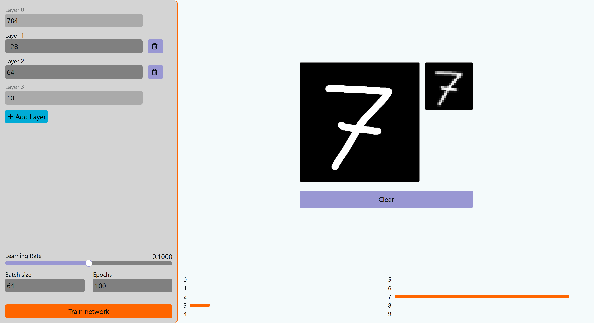
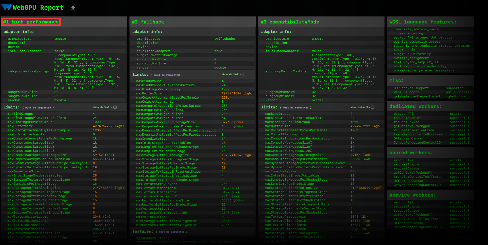
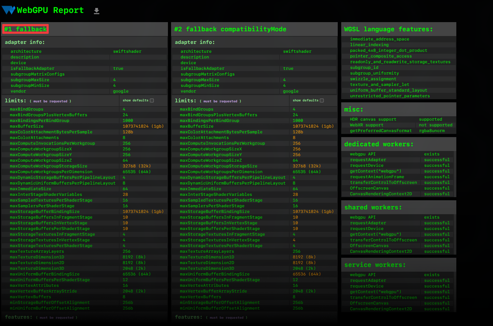
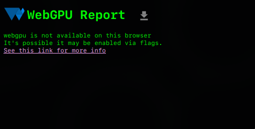

<div align="center">
    <h1>Neurorust</h1>
</div>

<div align="center">
    <p>
        
    </p>
    <p>
        Neurorust lets you train a simple neural network in your browser,
        using the GPU. The network predicts handwritten digits. After
        training you can draw your own digits and see its predictions.
    </p>
    <p>
        <picture>
            <source media="(prefers-color-scheme: dark)" srcset="./branding/banner_dark.png">
            <source media="(prefers-color-scheme: light)" srcset="./branding/banner_light.png">
            
        </picture>
    </p>
    <a href="https://neurorust.toqtou.me">
        Demo
    </a>
</div>


## Features

- **On device.** Neurorust runs completley in your browser using WebGPU. After loading the web page you can even turn off your internet.
- **Digit prediction.** Neurorust predicts handwritten digits using MNIST, one of the most popular datasets.
- **Experiment.** You can build you own networks with different settings to get better (or worse) results.


## Running it locally

To run this project you need:
- [rust](https://rust-lang.org/tools/install/)
- [git](https://git-scm.com/install/windows)
- [node](https://nodejs.org/en/download)
- [wasm-pack](https://wasm-bindgen.github.io/wasm-pack/installer/)
- A browser supporting WebGPU (see [Compatibility](#Compatibility)).

In order to compile rust to web assembly you need to install the wasm32-unknown-unknown target:
```bash
rustup target add wasm32-unknown-unknown
```

To compile and run the website run the following:
```
git clone https://github.com/fritl/neurorust.git
cd neurorust/neural_net
wasm-pack build --release --target web --out-dir ../frontend/src/wasm-pkg/
cd ../frontend
npm i
npm run dev
```
Then just open [http://localhost:3000](http://localhost:3000)


## Hyperparameter tips

The best hyperparameters I found were the following:
- Architecture: 784 -> 128 -> 64 -> 10
- Learning rate: 0.1
- Batch size: 64
- Epochs: 50

Generally if you choose a batch size like 256 training is much faster.
The more epochs you choose the better the accuracy you get but if you push it
too far it won't get better.


## How it works

Everyone knows that the GPU is really powerful for AI. I wanted to see how
exactly it can make my neural net faster. Rust has excellent libraries for
this. I used `wgpu` to communicate with the GPU and `wasm-pack` to compile
everything to WebAssembly. This let me run the whole network in the browser
on the GPU with  no server needed.

You can try it yourself. Load the website, turn off your internet and
start training.


## Compatibility

WebGPU is a relatively new addition to browser therefore compatibility is still
a bit tricky. The easiest way to check compatibility on your device is to visit
[webgpureport.org](https://webgpureport.org).

If WebGPU is available you will see one _high performance_ adapter. If you see
this Neurorust will most likely work


WebGPU has a fallback mode which uses all CPU cores instead of an actual GPU.
While Neurorust still works with the fallback it is not recommended to run.
Your CPU will get really hot and your system might freeze during the time of
training.


If WebGPU is not available in your browser you will see the following:


On Windows the latest version of your browser will most
likely support WebGPU. If not try updating your browser.

If you are using Linux WebGPU might be available with some additional flags.
There is no simple solution for every distro and browser. You should probably
consult the Internet or an LLM you trust.

On Apple devices WebGPU is enabled by default since version 26.0. It is
reccomended that you use Safari because other browsers might be significantly
slower or not work at all. Apple restricts GPU access in some cases. If
training does not work try plugging in your device or trying
again later.


## Possible improvements

Since this was my first time really using rust and the GPU for a project there
are a lot of locations that could be improved. If I ever revisit this project
or try to do it again here is what I would improve / do differently:

- **Matmul optimization.** While the GPU is really good at matrix operations
  the code to unlock its full potential is not straight forward. Matmul, for
  example, could probably be improved by at least 10x.
- **Code overall.** The whole Rust code could be cleaner. Because I have never
  really used `rust` or `wgpu` it was really hard to plan for everything
  beforehand. I learned a lot of thigns on the fly so I didn't account for them
  in my inital plan. Now that I know that I could account for it in the initial
  plan and write much cleaner code.
